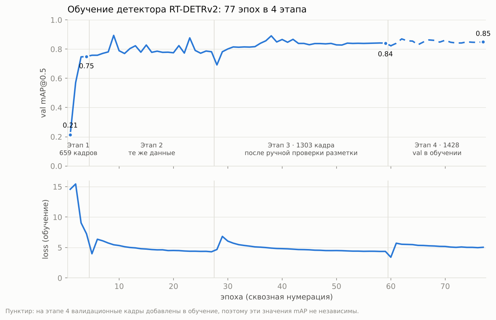

# Cash Compliance AI — контроль кассовой дисциплины по видео

**ForteBank · Datathon 26.** Сервис принимает видео кассы и сам находит нарушения кассовой дисциплины:
вердикт, тип нарушения, таймкод, 1–3 кадра-доказательства (лица размыты) и ссылку на пункт нормативного
акта РК с дословной цитатой. Работает **полностью локально**, без облачных ИИ-сервисов.
Все модели и библиотеки — с лицензиями для коммерческого использования (Apache-2.0 / BSD / MIT).

---

## 1. Как протестировать (для жюри)

| | |
|---|---|
| **Web interface URL** | `https://anniversary-convergence-democrat-pond.trycloudflare.com` |
| **API base URL** | `https://anniversary-convergence-democrat-pond.trycloudflare.com` |
| **API key** | передан в форме сдачи (заголовок `X-API-Key`) |
| Документация API (Swagger) | `<API base URL>/docs` |
| Проверка, что сервис жив | `<API base URL>/health` |

> Сервис запущен на компьютере команды и опубликован через Cloudflare Tunnel. Если адрес не открывается —
> напишите нам, пришлём актуальный (адрес туннеля меняется при перезапуске).

### 1.1. Через веб-интерфейс

1. Откройте **Web interface URL**, введите API-ключ (один раз, хранится только в вашем браузере).
2. **«Новый анализ»** → перетащите видео `.mov`/`.mp4` (можно несколько — встанут в очередь).
3. Через 20–150 с откройте результат: видео с красными метками нарушений на шкале времени, клик по метке
   или таймкоду перематывает к моменту; карточка нарушения — описание, норма РК с цитатой, кадры-доказательства.
4. Кнопки **«Подтвердить нарушение» / «Ложное срабатывание»** — решение сотрудника (человек в контуре).
5. **«История анализов»**, **«Нарушения»** — журнал всех проверок; **«Нормативная база»** — все нормы с цитатами;
   **JSON / Отчёт** — выгрузка и печать результата.

### 1.2. Через API (формат по разделу 10 ТЗ)

```bash
export API=https://anniversary-convergence-democrat-pond.trycloudflare.com
export KEY=<API key>

# 1) отправить видео -> job_id
curl -X POST "$API/api/v1/analyze" -H "X-API-Key: $KEY" -F "file=@video.mov"
# {"job_id": "a1b2c3d4", "status": "processing"}

# 2) получить результат (повторять, пока status = processing)
curl "$API/api/v1/jobs/a1b2c3d4" -H "X-API-Key: $KEY"
```

Ответ:

```json
{
  "job_id": "a1b2c3d4",
  "status": "done",
  "verdict": "violation",
  "violations": [
    {
      "type": "Наличные деньги оставлены вне средства хранения",
      "timecode_sec": 13.35,
      "description": "Около 13.4 c кассир покидает рабочее место (комната пуста с 17.8 c); на столе остались наличные деньги. Это может указывать на нарушение: «Все ранее принятые наличные деньги хранятся в специальных устройствах … закрывающихся на ключ …» (Постановление Правления Национального Банка РК от 29 ноября 2019 года № 231, п. 20). Требуется проверка человеком.",
      "evidence_frames": [{"timestamp_sec": 13.35, "image_base64": "<JPEG base64>"}],
      "rule": "п. 20: Все ранее принятые наличные деньги хранятся …",
      "source": "Постановление Правления НБРК от 29.11.2019 № 231 … https://adilet.zan.kz/rus/docs/V1900019680",
      "confidence": 0.7
    }
  ],
  "meta": {"duration_sec": 19.8, "fps": 30.0, "frames_analyzed": 198, "processing_sec": 21.4, "truncated": false}
}
```

| Поле | Значения |
|---|---|
| `status` | `processing` · `done` · `failed` |
| `verdict` | `violation` · `no_violation` |
| `timecode_sec` | секунды от начала видео (до 0.01 c) |
| `evidence_frames` | 1–3 кадра JPEG base64, лица размыты |
| `rule`, `source`, `confidence` | дополнительные поля: пункт и цитата нормы, акт со ссылкой на adilet, уверенность |

Без ключа или с неверным ключом — `401`. Неподдерживаемый файл — `415`.

**Зачем API-ключ.** Видео кассы — конфиденциальные данные банка. Ключ (требование ТЗ, раздел 10) не даёт
посторонним загружать видео, смотреть чужие результаты и занимать вычислительные ресурсы.

### 1.3. Проверка «как у жюри» одной командой

```bash
python scripts/api_smoke_test.py "$API" путь/к/видео.mov --key "$KEY"
# job_id ... status=done verdict=violation за 21.4 c  ✅ API соответствует схеме
```

---

## 2. Что распознаёт

| Нарушение | Что видит система | Норма РК |
|---|---|---|
| Наличные оставлены вне средства хранения | кассир ушёл, а деньги на столе; или подходит следующий клиент, а деньги прошлой операции лежат | Пост. НБРК №231, п. 20 |
| Сейф оставлен открытым | дверца сейфа открыта и не закрывается | Пост. НБРК №231, п. 20 |
| Кассир покинул рабочее место до окончания обслуживания | ушёл, на столе сумка инкассатора / незавершённая операция | Пост. НБРК №231, п. 22 |
| Рабочая станция не заблокирована | кассир ушёл, экран светится рабочей программой | Пост. АРРФР №53, п. 71 подп. 9 |
| Документы оставлены на столе | кассир ушёл, на столе бумаги | Пост. АРРФР №53, п. 76 |
| Дверь кассы оставлена открытой | дверь кассы открыта во время работы | Пост. НБРК №14, п. 16 подп. 1, п. 8 |
| Личные вещи в кассовом узле | сумка/одежда на рабочем столе | Пост. НБРК №231, п. 12 |
| Операция по документу третьего лица | у кассы трое, документ предъявляет не обслуживаемый клиент | Пост. НБРК №231, п. 19, 31; Закон о ПОД/ФТ ст. 5 |
| Инкассатор без удостоверения | операция с сумкой инкассатора без предъявления удостоверения | Пост. НБРК №231, п. 19, 31; Закон о ПОД/ФТ ст. 5 |

Ссылки на нормы берутся **только** из справочника `configs/regulations.yaml` (дословные цитаты, сверены с текстами
актов, редакции 2024–2026); модель ссылки не придумывает. Лица людей не распознаются — только размываются.

### 2.1. Что заложено, но пока не обрабатывается

Эти типы нарушений описаны в справочнике норм (`configs/regulations.yaml`, `enabled: false`), а для части
из них уже написаны правила. Но в ответ сервиса они **не попадают**. Мы выбрали точность: на открытых
роликах у системы 0 ложных тревог, и каждое из этих правил при включении либо давало ложные срабатывания,
либо его не на чем было проверить.

| Нарушение | Норма РК | Почему выключено |
|---|---|---|
| Наличные приняты без полистного пересчёта | НБРК №231, п. 19 подп. 2), п. 20 | нужно понимать движение рук, а детектор видит только объекты; «деньги в счётчике» размечены всего ~10 раз |
| Банкноты без проверки подлинности на оборудовании | НБРК №231, п. 19 подп. 2), п. 41 | та же причина: мало примеров использования счётчика, правило путало пересчёт с отсутствием проверки |
| Ключ оставлен в замке сейфа | НБРК №231, п. 80 | класс «ключ в замке» модель находит, но объект крошечный, а разметка противоречива (в ролике с нарушением ключ не отмечен, в нормальных — отмечен), отсюда ложные тревоги |
| Телефон с камерой в кассовом узле | НБРК №231, п. 12 | в датасете нет ни одного ролика с этим нарушением, поэтому точность не проверить |
| Клиент ушёл до завершения операции | НБРК №231, п. 31 подп. 4)–6), п. 35 | клиент часто за стеклом или вне кадра; уход клиента и уход инкассатора пока не различаются надёжно |
| Клиент допущен до готовности кассы | — | открытая норма РК с таким требованием не найдена, а без ссылки на норму тип не включаем |

Включаются они одной строкой `enabled: true` после дообучения на новой разметке. Код правил остаётся в
`src/detectors/rules.py`.

### 2.2. Известные ограничения

- **Идентификация клиента** проверяется только для инкассатора: удостоверение должно мелькнуть хотя бы
  в одном из визитов. Для обычного клиента документ сверху виден плохо, и проверка давала ложные тревоги.
- **Ракурс.** Пороги масштабируются по размеру счётчика банкнот или ноутбука, и стресс-тест на перекошенной
  перспективе прошёл без потери качества. Но если камера не видит стол и сейф (например, снимает
  со спины кассира), часть правил работать не сможет.
- **Освещение.** Свечение экрана определяется по яркости, поэтому в очень тёмной или пересвеченной сцене
  «экран не заблокирован» может пропускаться.
- **Длинные видео.** Видео длиннее ~2,5 минут анализируется с пониженной частотой кадров, чтобы уложиться
  в лимит 5 минут: очень короткие события (меньше 1 с) могут быть пропущены.
- **Звук** не используется (по условиям кейса анализ только визуальный).
- **Лица** не распознаются и не идентифицируются. На кадрах-доказательствах они размываются детектором
  лиц OpenCV, но при съёмке сверху лицо, повёрнутое от камеры, детектор может не найти.
- **Сервис** работает на одном компьютере, видео обрабатываются по очереди. При одновременной отправке
  многих роликов время ответа растёт.

---

## 3. Как устроено

```
видео ─► кадры по реальному времени (OpenCV, 10 к/с; длинные видео — реже, чтобы уложиться в 5 мин)
      ─► детектор RT-DETRv2 (Apache-2.0), дообучен на 1386 размеченных кадрах, 17 классов:
         деньги, деньги в счётчике, удостоверение, счётчик банкнот, ноутбук, экран включён / заблокирован,
         сейф открыт / закрыт, ключ в замке, дверь открыта / закрыта, сумка инкассатора, личные вещи, документы
      ─► люди: RT-DETRv2 (COCO) + собственный IoU-трекер
      ─► пиксельные признаки: свечение экрана, «отпечаток» двери, яркость кадра
      ─► устойчивость во времени (объект засчитывается, если виден в ≥2 из 5 соседних кадров)
      ─► сцена без ручной разметки зон: кто в комнате (люди за стеклом и отражения отсекаются),
         пороги масштабируются по размеру счётчика/ноутбука — работает на другом ракурсе
      ─► правила по временной шкале (уход кассира, следующий клиент, сейф, дверь, третье лицо…)
      ─► норма из справочника + кадры-доказательства с размытыми лицами ─► JSON по ТЗ
```

Подробно: `docs/RULES.md` (правила, пороги, проверка), `docs/ARCHITECTURE.md`.

### Модели и лицензии

| Модель | Назначение | Лицензия |
|---|---|---|
| PekingU/rtdetr_v2_r18vd (20 млн параметров) | люди; основа для дообучения | Apache-2.0 |
| RT-DETRv2, дообученная командой (77 эпох в 4 этапа) | объекты кассы, 17 классов | Apache-2.0 (производная) |
| google/owlv2-base-patch16-ensemble | только черновики при разметке | Apache-2.0 |

Библиотеки: PyTorch, torchvision (BSD), transformers (Apache-2.0), OpenCV (Apache-2.0), FastAPI (MIT).
Компоненты под AGPL (YOLO/ultralytics) в проекте не используются.

---

## 4. Качество

Проверка на 42 открытых роликах (22 с нарушением, 20 без) — тем же способом, что у жюри:

| Метрика | Обычные ролики | Стресс-тест «камера сбоку»* |
|---|---|---|
| Accuracy вердикта | **0.83** | **0.86** |
| Precision (ложных тревог) | **1.00** (0 из 20) | **1.00** |
| F1 | **0.81** | **0.84** |
| Ошибка таймкода | медиана 1.6 c | — |
| Время на видео | 20–95 c (5-мин видео ≈ 150 c; лимит 300 c) | — |

\* все ролики искусственно перекошены перспективой, которую модель не видела при обучении — оценка работы
на новом ракурсе камеры. Система настроена на отсутствие ложных тревог: спорные случаи не помечаются.

### 4.1. Какие метрики использовались

**Уровень видео (главное — так оценивает жюри).** Прогоняем все 42 открытых ролика через тот же API
(`scripts/eval_timelines.py`) и сравниваем с таблицей разметки команды:

| Метрика | Что значит |
|---|---|
| Accuracy | доля роликов с верным вердиктом `violation` / `no_violation` |
| Precision | из всех тревог — сколько настоящих (у нас 1.00 = ни одного ложного обвинения) |
| Recall | из 22 роликов с нарушением — сколько найдено |
| F1 | среднее гармоническое precision и recall |
| Ошибка таймкода | медиана расхождения `timecode_sec` с разметкой и доля попаданий в ±2 c |
| Совпадение типа | тип нарушения совпал с таблицей команды |

**Уровень детектора (обучение нейросети).**
- **mAP@0.5** — средняя точность обнаружения по классам при пересечении рамок IoU ≥ 0.5, считается после
  каждой эпохи отдельно по каждому классу и в среднем.
- **Валидация — 4 целых ролика (X-3, X-10, X-33, X-39), которых нет в обучении.** Мы не брали случайные
  кадры: соседние кадры одного видео почти одинаковы, и метрика была бы завышена.
- **loss** — функция потерь RT-DETR на обучении (классификация VFL + L1 и GIoU для рамок).

### 4.2. Как менялись метрики: от первой эпохи до последней



Детектор обучался **77 эпох в 4 этапа**. Каждый этап продолжает с весов предыдущего; все значения по
эпохам лежат в `docs/training_metrics.csv`.

| Этап | Эпохи | Данные | val mAP@0.5: начало → конец | Что менялось |
|---|---|---|---|---|
| 1 | 1–4 | 659 кадров | **0.21 → 0.75** | старт с весов COCO, модель учит классы кассы |
| 2 | 5–27 | те же 659 | 0.76 → 0.78 | дообучение; рост упёрся в объём и качество разметки |
| 3 | 28–59 | **1303 кадра** после ручной проверки | 0.69 → **0.84** | новые классы (ключ, экран вкл./блокировка, сейф открыт, деньги в счётчике) |
| 4 | 60–77 | 1428 (train + val) | 0.82 → 0.85* | финальная модель: редкие классы ×3, искажения перспективы для других ракурсов |

\* На этапе 4 валидационные ролики добавлены в обучение, чтобы модель увидела все данные перед сдачей,
поэтому эти значения уже не независимы. Честная оценка детектора — **0.84 после этапа 3**, а качество
финальной системы видно по метрикам уровня видео ниже.

Почему на графике есть скачки:
- **Loss растёт в начале этапов 2–4.** Первая эпоха идёт на малом шаге обучения (разогрев), со второй шаг
  полный и добавлены новые данные и аугментации. После скачка loss снова снижается. На этапе 4 loss выше,
  чем на этапе 3, специально: аугментации сильнее (перспектива, повтор трудных кадров).
- **Пики 0.89 (эпохи 9 и 38)** — шум маленькой валидации. На эпохе 38 редкий класс «деньги в счётчике»
  (несколько примеров) случайно дал 1.0. Мы выбирали устойчивую модель, а не случайный пик.

**По классам (val mAP@0.5):**

| Класс | Эпоха 1 | Конец этапа 1 | Конец этапа 3 | Финал* |
|---|---|---|---|---|
| деньги | 0.02 | 0.68 | 0.83 | 0.86 |
| удостоверение | 0.00 | 0.81 | 0.93 | 0.93 |
| счётчик банкнот | 0.72 | 1.00 | 1.00 | 1.00 |
| сейф закрыт | 0.71 | 1.00 | 1.00 | 1.00 |
| дверь открыта | 0.00 | 0.99 | 1.00 | 1.00 |
| экран включён | — | — | 0.97 | 0.99 |
| экран заблокирован | — | — | 0.96 | 0.87 |
| ключ в замке | — | — | 0.94 | 0.92 |
| деньги в счётчике | — | — | 0.31 | 0.50 |
| телефон | 0.00 | 0.08 | 0.00 | 0.00 |

«—» — класса ещё не было в разметке. «Деньги в счётчике» и «телефон» остаются слабыми из-за
единичных примеров, поэтому зависящие от них нарушения выключены (см. 2.1).

**Уровень видео по версиям системы (42 ролика):**

| Версия | Accuracy | Precision | Recall | F1 | Таймкод (медиана / в ±2 c) |
|---|---|---|---|---|---|
| Первый прототип (17.10; другой детектор, заменён на RT-DETRv2 по лицензии) + базовые правила | 0.74 | 1.00 | 11/22 = 0.50 | 0.67 | 1.6 c / 55 % |
| RT-DETRv2 после этапа 3 + правила экрана, документов, двери | 0.81 | 1.00 | 14/22 = 0.64 | 0.78 | 2.1 c / 50 % |
| **Финал: RT-DETRv2 этап 4 + устойчивость во времени и уточнённые правила** | **0.83** | **1.00** | 15/22 = 0.68 | **0.81** | 1.6 c / 53 % |
| Финал, стресс-тест «камера сбоку» | 0.86 | 1.00 | 16/22 = 0.73 | 0.84 | — |

На всех версиях precision = 1.00: каждое улучшение мы принимали, только если оно не добавляло
ни одной ложной тревоги.

---

## 5. Запуск у себя (офлайн)

Требования: macOS / Linux, Python 3.11, ffmpeg; Apple Silicon (MPS) или NVIDIA GPU (CPU — медленнее).

```bash
git clone https://github.com/Hotel-zulu/ForteDatathon.git && cd ForteDatathon
python3.11 -m venv .venv && source .venv/bin/activate
pip install -r requirements.txt -r requirements-ml.txt
cp .env.example .env            # задать API_KEY

# веса (в git не хранятся, ~160 МБ):
#  models/rtdetr_v2_r18vd  — python -c "from huggingface_hub import snapshot_download as d; d('PekingU/rtdetr_v2_r18vd', local_dir='models/rtdetr_v2_r18vd')"
#  models/rtdetr_cashier   — наша дообученная модель (архив передаётся вместе с решением)

uvicorn api.main:app --host 0.0.0.0 --port 8000
# веб-интерфейс: http://localhost:8000     API: http://localhost:8000/api/v1/...
```

Docker: `docker compose up --build` (веса должны лежать в `models/` до сборки; интернет при работе не нужен).

Переменные `.env`: `API_KEY`, `SAMPLE_FPS` (10), `MAX_SIDE` (960), `TIME_BUDGET_SEC` (240), `MAX_FRAMES` (1500),
`BLUR_FACES` (1), `PERCEPTION` (`rtdetr`).

---

## 6. Структура репозитория

```
api/main.py              API по ТЗ + данные для веб-панели (история, статистика, проверка человеком)
app/index.html           веб-панель (один файл, без внешних библиотек и интернета)
src/pipeline.py          analyze(video) -> вердикт, нарушения, кадры
src/detectors/           rtdetr_perception (модели), scene (сцена), rules (правила), pixels (признаки)
src/evidence.py          кадры-доказательства: размытие лиц, рамки, JPEG base64
configs/regulations.yaml справочник «нарушение -> акт, пункт, дословная цитата» (единственный источник ссылок)
scripts/                 train_rtdetr, dump_timelines, eval_timelines (метрики, стресс-тест), api_smoke_test,
                         batch_analyze, label_qa, label_studio (разметка)
docs/RULES.md            правила, пороги, метрики
```

Данные организаторов (видео, разметка) в репозитории не хранятся — используются только в рамках хакатона.
